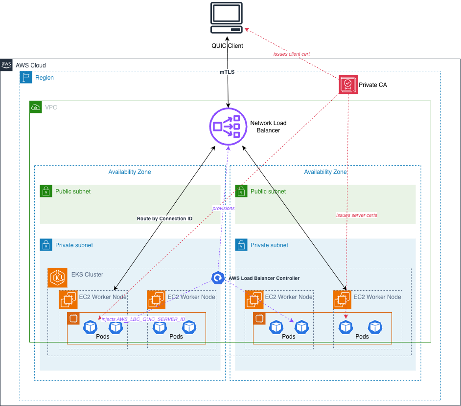

# mTLS over QUIC on AWS Network Load Balancer

A working reference implementation of mutual TLS authentication over QUIC, terminated at application pods on Amazon EKS behind an AWS Network Load Balancer running in passthrough mode.

The Network Load Balancer forwards QUIC packets at the packet layer without decrypting them. Server pods handle the full mTLS handshake, including verification of client certificates. The AWS Load Balancer Controller provisions the NLB, injects each pod's Server ID as an environment variable, and registers pods as targets. AWS Private CA issues both server and client certificates.

## Architecture



Runtime data path (solid arrows):

1. QUIC client dials the NLB DNS name and performs a TLS 1.3 mTLS handshake inside QUIC. The NLB does not terminate TLS.
2. NLB routes each QUIC packet to a specific pod using the 17-byte Destination Connection ID. Bytes 1-8 of the DCID contain the pod's `Server ID` — a value the AWS Load Balancer Controller injected into the pod's environment.

Control plane (dashed arrows):

- **AWS Load Balancer Controller** — provisions the NLB from the Kubernetes `Service` and injects `AWS_LBC_QUIC_SERVER_ID` into each pod.
- **AWS Private Certificate Authority** — issues the fleet CA, the server certificate, and each client certificate.

## Prerequisites

- An AWS account with permission to create Amazon EKS clusters, IAM roles and policies, Amazon VPCs, Network Load Balancers, Amazon ECR repositories, and AWS Private CAs.
- Session credentials that will last at least 60 minutes (initial cluster creation alone takes about 15 minutes).
- Local tools: AWS CLI v2, `kubectl`, `eksctl`, `helm`, `go` (1.24+), and a container build tool (`finch`, Docker, or Podman). `jq` is used by a couple of verification commands.

The AWS Load Balancer Controller must be **[v2.17.1 or later](https://github.com/kubernetes-sigs/aws-load-balancer-controller/releases/tag/v2.17.1)** — that release introduced QUIC support. The install script in this repo pins to v3.5.0.

## Walkthrough

All commands assume you are in the repository root and have `AWS_REGION` set. `us-west-2` is the default in `scripts/cluster.yaml`; adjust that file if you use a different region.

```bash
export AWS_REGION=us-west-2
export AWS_ACCOUNT_ID=$(aws sts get-caller-identity --query Account --output text)
```

### Step 1: Create the Amazon EKS cluster (~15 min)

`scripts/cluster.yaml` defines a two-node managed node group with OIDC enabled (required for [IRSA](https://docs.aws.amazon.com/eks/latest/userguide/iam-roles-for-service-accounts.html), which the Load Balancer Controller uses).

```bash
eksctl create cluster -f scripts/cluster.yaml
kubectl get nodes
```

Most of the 15 minutes is AWS provisioning the managed Kubernetes control plane. There is no way to reduce it meaningfully.

### Step 2: Install the AWS Load Balancer Controller (~3 min)

```bash
bash scripts/install-lbc.sh
kubectl -n kube-system rollout status deploy/aws-load-balancer-controller
```

The script creates the IAM policy, an IRSA-backed service account, and installs the helm chart pinned to v3.5.0 (controller image v3.5.0).

### Step 3: Enable Server ID injection on the application namespace

The LBC injects `AWS_LBC_QUIC_SERVER_ID` into pods only when both the **namespace** is labeled and each **pod** is annotated. The label opts the namespace in; the pod annotation names the container to inject into.

```bash
kubectl apply -f manifests/00-namespace.yaml
kubectl get ns quic-example --show-labels
```

The namespace must show `elbv2.k8s.aws/quic-server-id-inject=enabled` in the `LABELS` column.

### Step 4: Prepare the TLS material

`scripts/gen-certs.sh` provisions a general-purpose AWS Private CA, issues a server cert (`CN=quic-example.local`) and a client cert (`CN=drone-001`) from it, and saves the CA ARN to `certs/ca.arn` for teardown. It also generates a self-signed cert with OpenSSL that is deliberately **not** signed by the fleet CA — used in Step 9 as the untrusted-cert negative test case.

```bash
bash scripts/gen-certs.sh

kubectl -n quic-example create secret generic quic-server-tls \
  --from-file=tls.crt=certs/server.crt \
  --from-file=tls.key=certs/server.key \
  --from-file=ca.crt=certs/ca.crt
```

Verify the three keys are present:

```bash
kubectl -n quic-example get secret quic-server-tls -o jsonpath='{.data}' | jq 'keys'
```

Expected output:

```
["ca.crt", "tls.crt", "tls.key"]
```

### Step 5: Build and push the container image

The server image is a minimal Alpine base with a cross-compiled Go binary. Compiling on the host (rather than inside the container) avoids QEMU / DNS issues that can occur running the Go toolchain in `finch build` on Apple Silicon.

```bash
export IMAGE=${AWS_ACCOUNT_ID}.dkr.ecr.${AWS_REGION}.amazonaws.com/quic-nlb-demo:v1

aws ecr create-repository --repository-name quic-nlb-demo --region $AWS_REGION \
  --image-scanning-configuration scanOnPush=true

aws ecr get-login-password --region $AWS_REGION | \
  finch login --username AWS --password-stdin \
  ${AWS_ACCOUNT_ID}.dkr.ecr.${AWS_REGION}.amazonaws.com

cd server
GOOS=linux GOARCH=amd64 CGO_ENABLED=0 go build -o quic-server .
finch build --platform linux/amd64 -t "$IMAGE" .
finch push "$IMAGE"
cd ..
```

Deploy the baseline (server-only TLS, mTLS not yet enabled):

```bash
sed "s|IMAGE_PLACEHOLDER|$IMAGE|" manifests/10-deployment-baseline.yaml | kubectl apply -f -
kubectl -n quic-example rollout status deploy/quic-server
```

Confirm each pod received a Server ID:

```bash
kubectl -n quic-example get po -o json | jq -r \
  '.items[] | .metadata.name as $n | .spec.containers[0].env[]? |
   select(.name=="AWS_LBC_QUIC_SERVER_ID") | "\($n)\t\(.value)"'
```

Each pod should show a base64-encoded 8-byte Server ID.

### Step 6: Provision the QUIC-enabled NLB (~3 min)

Apply the Service. The six annotations tell the LBC to create an NLB with a combined TCP+UDP listener on port 443 and upgrade the UDP path to QUIC (producing a `TCP_QUIC` listener protocol).

```bash
kubectl apply -f manifests/20-service-quic.yaml
```

Wait for the NLB to provision and for DNS to propagate. This typically takes 2–3 minutes:

```bash
until NLB=$(kubectl -n quic-example get svc quic-service \
  -o jsonpath='{.status.loadBalancer.ingress[0].hostname}') && \
  [ -n "$NLB" ] && nslookup "$NLB" >/dev/null 2>&1; do
  echo "waiting for NLB DNS..."; sleep 10
done
echo "NLB DNS: $NLB"
```

Verify the listener protocol is `TCP_QUIC`:

```bash
LB_ARN=$(aws elbv2 describe-load-balancers --region $AWS_REGION \
  --names quic-nlb-demo --query 'LoadBalancers[0].LoadBalancerArn' --output text)
aws elbv2 describe-listeners --region $AWS_REGION --load-balancer-arn "$LB_ARN" \
  --query 'Listeners[*].[Port,Protocol]' --output table
```

Expected: `443  TCP_QUIC`.

### Step 7: Verify server-only TLS end-to-end

Build the client and dial the NLB with no client cert (mTLS is not enabled yet):

```bash
cd client && go build -o quic-client . && cd ..

./client/quic-client --target "$NLB:443" --sni quic-example.local \
  --ca certs/ca.crt --no-client-cert
```

Expected output:

```
server said: hello from quic-server-<hash>-<pod> @ 2026-...
```

### Step 8: Enable mTLS

Roll out the mTLS deployment. It is identical to Step 5's baseline except it sets `MTLS_ENABLED=true` on the container, which switches the server's `crypto/tls.Config` to `ClientAuth: RequireAndVerifyClientCert`.

```bash
sed "s|IMAGE_PLACEHOLDER|$IMAGE|" manifests/30-deployment-mtls.yaml | kubectl apply -f -
kubectl -n quic-example rollout status deploy/quic-server
sleep 30    # allow the NLB to re-register the new pods
```

Confirm the pods are in mTLS mode:

```bash
kubectl -n quic-example logs -l app=quic-server --tail=5 --prefix=true | grep mTLS
```

Expected output (one line per pod):

```
mTLS: RequireAndVerifyClientCert against CA /etc/quic/ca.crt
```

### Step 9: Test the mTLS handshake

Three cases exercise the mTLS test matrix. A connection with a valid client cert should succeed; the other two should fail with `CRYPTO_ERROR 0x174: tls: certificate required` before any application data reaches the server.

```bash
# Case 1: valid client cert (should succeed)
./client/quic-client --target "$NLB:443" --sni quic-example.local \
  --ca certs/ca.crt --cert certs/client.crt --key certs/client.key

# Case 2: no client cert (should fail)
./client/quic-client --target "$NLB:443" --sni quic-example.local \
  --ca certs/ca.crt --no-client-cert

# Case 3: untrusted client cert (should fail)
./client/quic-client --target "$NLB:443" --sni quic-example.local \
  --ca certs/ca.crt --cert certs/badclient.crt --key certs/badclient.key
```

Server-side verification for the successful case:

```bash
kubectl -n quic-example logs -l app=quic-server --tail=30 --prefix=true | grep 'peer cert'
```

Expected output (Case 1 only):

```
peer cert[0] subject="CN=drone-001,O=fleet-demo" issuer="CN=quic-nlb-demo Fleet CA,O=quic-nlb-demo,C=US"
```

## Connection ID Requirements

NLB uses the [QUIC-LB specification](https://datatracker.ietf.org/doc/draft-ietf-quic-load-balancers/) to extract the Server ID from the Destination Connection ID. The required layout is a fixed 17 bytes:

- **Byte 0** — config rotation identifier. Use `0x00`.
- **Bytes 1-8** — the 8-byte Server ID. Base64-decode `AWS_LBC_QUIC_SERVER_ID` and place the raw bytes here.
- **Bytes 9-16** — 8-byte nonce. Random or counter-based; NLB ignores it for routing.

The reference server implements this by satisfying the `ConnectionIDGenerator` interface on the quic-go `Transport`. See `server/main.go`.

NLB drops non-Initial long-header packets (Handshake, 0-RTT, Retry) whose DCID is not exactly 17 bytes. Non-Envoy servers must use a full 8-byte nonce. Envoy uses a 7-byte nonce because it prepends a 1-byte worker ID — that layout does not apply here.

## Optional: packet-level verification

Two scripts inspect a captured pcap to confirm the wire format:

- `scripts/parse-quic-dcid.py` — prints the DCID hex for every QUIC long-header packet, so you can verify every 17-byte DCID begins with `00` followed by one of the pod Server IDs.
- `scripts/pcap-summary.py` — groups packets by direction and QUIC packet type. A healthy handshake shows non-zero counts of 1-RTT packets in both directions.

Capture a pcap using `kubectl debug` with the `nicolaka/netshoot` image while running a few client connections, then run the scripts against the resulting file.

## Cleaning up

```bash
bash scripts/teardown.sh
```

Removes the Kubernetes Service (which triggers NLB deletion), the demo namespace, the AWS Load Balancer Controller helm release and its IRSA service account, the ECR repository, the EKS cluster, and the `AWSLoadBalancerControllerIAMPolicy` IAM policy. Also disables the AWS Private CA and schedules it for permanent deletion with a 7-day recovery window (the AWS-enforced minimum).

Verify:

```bash
aws eks list-clusters --region $AWS_REGION
aws elbv2 describe-load-balancers --region $AWS_REGION
aws ecr describe-repositories --region $AWS_REGION
aws acm-pca list-certificate-authorities --region $AWS_REGION
```

You are not billed for the AWS Private CA once it is disabled; the 7-day recovery window is a soft-delete grace period, not additional runtime.

## Repository layout

```
manifests/
├── 00-namespace.yaml            # Namespace with Server ID injection label
├── 10-deployment-baseline.yaml  # Server-only TLS deployment (baseline)
├── 20-service-quic.yaml         # Service that provisions the QUIC-enabled NLB
└── 30-deployment-mtls.yaml      # Same as baseline with MTLS_ENABLED=true

server/                          # quic-go server + Dockerfile (minimal Alpine)
client/                          # quic-go client used for handshake testing

scripts/
├── cluster.yaml                 # eksctl cluster configuration
├── install-lbc.sh               # AWS Load Balancer Controller installer
├── gen-certs.sh                 # Provisions AWS Private CA, issues certs
├── teardown.sh                  # Full cleanup (all AWS resources)
├── parse-quic-dcid.py           # DCID structural inspection (verification)
└── pcap-summary.py              # Bidirectional flow inspection (verification)

images/
└── QUIConNLB-updated.png        # Architecture diagram

certs/                           # Populated by scripts/gen-certs.sh (gitignored)
```

## Cost

Approximately **$6-8 per day** while the demo runs:

| Component | Approximate cost | Notes |
|---|---|---|
| EKS control plane | $0.10 / hour | Fixed per cluster |
| 2× t3.medium nodes | $0.083 / hour | On-demand, us-west-2 |
| Network Load Balancer | ~$0.03 / hour | Plus LCU-based charges under traffic |
| AWS Private CA (general-purpose) | ~$0.55 / hour prorated | Also charged per issued certificate (fractions of a cent at demo scale) |
| Data transfer, ECR storage | pennies | At demo scale |

Run `bash scripts/teardown.sh` when finished. PCA charges stop as soon as the CA is disabled.


## Security

See [CONTRIBUTING](CONTRIBUTING.md#security-issue-notifications) for more information.

## License

This library is licensed under the MIT-0 License. See the LICENSE file.
